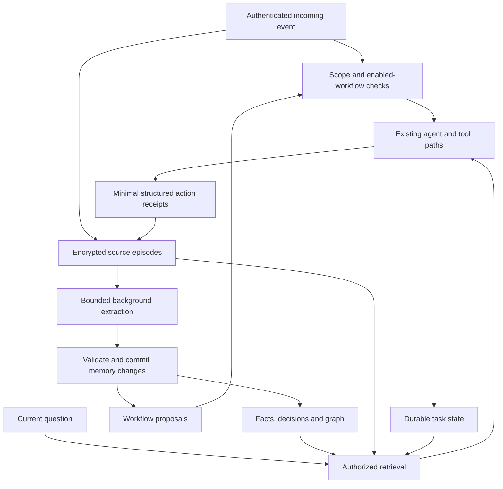

# Proposal: source-backed memory, standing workflows and task continuity

Status: proposal, not implemented.  
Prepared: 11 October 2026.  
Code baseline reviewed: `c4805e3`.  
Target: a Raspberry Pi as the primary host, with an optional laptop for browser and coding services.

## Recommendation

Build a small memory subsystem inside Inkling's existing TypeScript application. Give it source-backed records for facts, decisions, standing workflows and unfinished tasks, then add a lightweight graph over those records.

The Pi must remain able to retrieve memories and respond when the laptop is unavailable. Use the existing encrypted storage, bounded in-memory indexes and asynchronous model extraction. Do not require a graph database, a new agent framework or a second always-on host in v1.

The main objective is reliable continuity: distinguish what the user requested, what the assistant remembers, what code actually supports, what a tool attempted and what was verified. A graph is an index over that evidence, not a replacement for it.

## Evidence and its limits

This proposal combines three kinds of evidence:

1. **Code inspection:** the repository's history, notes, retrieval, scheduler, tool, list and coding paths.
2. **Deployment review:** narrowly selected owner-private exchanges, the owner's relevant shared-group messages, matching saved notes and sanitized service-log aggregates for 9–11 October 2026. Other users' private chats were not inspected. No downloaded conversation archive was created.
3. **Research:** original papers and implementation documentation, linked below.

Private message quotations, personal identities, email addresses, deployment addresses and credentials are intentionally excluded. Conversation findings below are paraphrases. The underlying private evidence stays on the deployment; these summaries are not public transcripts or independently reproducible benchmarks.

Observed patterns establish requirements, not definitive causes for every incident. The log window includes deployments and earlier fixes. Tool-call counts do not prove successful actions, audible playback or good replies.

### Observations that drive the design

| ID | Observed evidence | Architectural implication |
| --- | --- | --- |
| E1 | The owner defined a recurring link workflow: read a bare link, save it and summarize it; hiring material has a separate application flow. | Represent standing workflows explicitly, including triggers and destinations. |
| E2 | The owner requested a common links collection across private and group use. Saved notes contain both that request and a contradictory instruction to keep the collections separate. Assistant replies also contradicted one another. | Track the source and authority of decisions; make sharing a resource setting rather than a prose claim. |
| E3 | The owner had to explain the workflow again in the group and reported an unprocessed link. | Workflow activation and group dispatch require code, not merely better recall. |
| E4 | The owner specified English summaries, approximate summary length and browser-tab cleanup. | Attach preferences and completion requirements to the relevant workflow. |
| E5 | Coding follow-ups required repeated context, including a request to supply a repository URL again. | Retain trusted project references separately from transient chat history. |
| E6 | A requested coding action was blocked by laptop unavailability; resumption was left to another message. | Persist pending intent and blockers on the Pi, without assuming that reconnecting permits automatic execution. |
| E7 | The owner asked for a more informative maintenance failure notification; the assistant could not establish the failed step from the information available to it. | Provide structured operational incidents with evidence, rather than relying on personal memory or guesses. |
| E8 | Sanitized logs contain 18 note-cleanup failures; all 18 are `SyntaxError` failures with `JSON.parse` in the stack. | Fix validation and failure handling before expanding model-generated memory updates. The exact invalid outputs and upstream cause have not been established. |
| E9 | Logs include 11 result/receipt corrections and two corrections for action claims without a tool call. | Keep assistant reports distinct from verified tool outcomes. These counts describe this window, not current failure rates. |
| E10 | The reviewed deployment has tens of saved notes, and its retained history covers only part of its lifetime. | Start with bounded local storage. Backfill available evidence without claiming to reconstruct everything. |

## Current implementation

| Component | Current behavior | Relevant gap |
| --- | --- | --- |
| [`store.ts`](../src/store.ts), `Turn`, `appendHistory`, `archiveTurns` | Stores role and text, retains approximately 40–60 recent entries and up to 3,000 archived entries per chat. | IDs, speakers, origin and timestamps are not structured turn fields. Some timestamps and group attribution are embedded in text. |
| [`memory.ts`](../src/memory.ts), `refreshRecap`, `recall` | Maintains a running recap and retrieves archive passages by matching words. | Summaries are lossy; exact word matching misses paraphrases and cross-language wording. |
| [`agent.ts`](../src/agent.ts), `remember`, `forget` | Saves dated string notes; forgetting removes selected notes and clears the tidy backup. | Notes lack source links. An old statement may remain in history and be extracted again. |
| [`memory.ts`](../src/memory.ts), `tidyNotes` | Requests structured model output and parses it directly; generally favors newer notes. | Invalid output fails cleanup; date order alone cannot resolve attribution or historical changes. |
| [`index.ts`](../src/index.ts), inbound group dispatch | Unaddressed group messages become recent context, except for the separate auto-reply path. | A bare-link workflow cannot activate simply because a note says it should. |
| [`lists.ts`](../src/lists.ts), `handleList` | Lists are stored and resolved by chat. | A list with the same name in two chats is not one shared collection. |
| [`coding.ts`](../src/coding.ts), `controlCoding` | Existing projects can be continued; a supplied repository URL must appear in the current owner request. | The model can unnecessarily supply that field on continuation. Existing project identity should be resolved without weakening source-import authorization. |
| [`vault.ts`](../src/vault.ts) | Encrypts JSON and atomically replaces individual files. | Reuse this boundary; individual atomic writes do not make a multi-file update transactional. |

Scheduled prompts can also appear as `user` entries in history. New source metadata must distinguish human messages from automatic work. Role alone is insufficient evidence of a user's instruction.

## Proposed architecture

Workflow proposals only enter dispatch after application-level validation and activation. Graph extraction cannot enable arbitrary actions or change access policy.

### 1. Source episodes and provenance

**Build:** stable IDs for source messages, small conversation episodes and selected action receipts. Store structured chat scope, actor, origin, message time, timezone and references to derived records. Preserve a short source passage where necessary and permitted by retention.

**Evidence:** E2 and E9 show why the assistant's wording cannot be treated as the user's decision or proof of execution. The current `Turn` representation cannot reliably express those distinctions. LongMemEval finds that replacing passages with extracted facts can lose useful information [R4]. Graphiti links derived facts back to episodes [R3].

**Rules:**

- Distinguish `human_message`, `assistant_reply`, `scheduled_event`, `tool_receipt` and `legacy_summary`.
- A fact's subject can differ from its speaker. A person reporting someone else's preference is not that other person's explicit statement.
- Source spans must match an existing source record. The model cannot invent a source ID or quotation.
- Assistant replies remain searchable discussion, but are not independently verified outcomes.
- Do not persist hidden model reasoning, raw credentials or wholesale tool payloads.

**Acceptance:** every new extracted claim resolves to existing evidence; scheduled text cannot masquerade as a fresh human instruction; duplicate deliveries do not duplicate episodes.

### 2. Versioned facts, preferences and decisions

**Build:** structured records with subject, relationship, object/value, scope, source references, attribution, evidence type and lifecycle status. Record both when a statement was learned and when it was true, if known. Unknown times stay unknown.

**Evidence:** E2 contains an actual contradictory pair. E4 shows that preferences can belong to a specific activity. Mem0 uses explicit memory-update operations [R2]; Graphiti preserves temporal validity [R3].

**Rules:**

- A direct user correction outranks an assistant paraphrase of that user's earlier request.
- Newer ingestion is not automatically newer truth. A recent message can describe a past state.
- Distinguish `active`, `superseded`, `disputed` and `retracted`; project decisions can additionally describe states such as parked or resumed.
- Preserve stated reasons and alternatives. Do not manufacture causality from nearby messages.
- Keep inferred patterns qualified. Repetition of the assistant's own summary is not corroboration.
- For relationships that permit multiple values, adding one must not invalidate all others.

**Acceptance:** an assistant's contradictory response cannot override the owner's explicit request; historical questions return the relevant past state; unsupported reasoning is identified as unknown.

### 3. Standing-workflow registry

**Build:** a small declarative registry over supported capabilities. Each workflow defines its trigger, authorized actors/chats, steps, destination resource, preferences, limits, source instruction, version and enabled state.

**Evidence:** E1, E3 and E4 are recurring behavioral requests, not merely personal facts. `index.ts` currently gates normal group processing on addressing the assistant. LangMem distinguishes factual memory from procedural behavior [R5].

**Initial supported workflow:** classify a link, read it using available tools, produce the requested summary and save a structured collection item. Add application reminders through the existing reminder system when authorized; the graph does not schedule anything itself.

**Rules:**

- Only known step types and existing tool permissions are allowed. No model-written scripts or arbitrary execution.
- Group bare-link dispatch is an explicit exception for enabled workflows and permitted senders, evaluated before the normal name gate.
- Parse real message text separately from preview metadata and quoted content. Link-plus-text follows the actual request, rather than blindly activating the bare-link rule.
- Workflow memory, supported capability and enabled behavior are separate states. Never claim activation from saving a note alone.
- Browser cleanup is a real execution requirement. Add capability where missing; otherwise report the limitation.
- Outgoing email, personal WhatsApp messages, invites and browser final steps retain their existing confirmation requirements.
- External page contents cannot create workflows or change their scope.

**Acceptance:** a permitted bare link in an enabled group runs once; a disabled workflow or unpermitted sender does not activate it; partial failure produces an accurate result; no confirmation is bypassed.

### 4. Collections with explicit sharing

**Build:** stable collection IDs and an access-controlled mapping from chat-local names to resources. Private lists remain the default. Shared collections are explicitly created or designated, with reader/writer scopes and authorization checked on every operation.

**Evidence:** E2 requests shared behavior that `lists.ts` does not implement. Reusing the same list name currently creates separate stores. Copying private notes into a group would solve the wrong problem and violate privacy.

**Rules:**

- A shared collection contains approved items, not the owner's private history, profile or connector data.
- Do not publish existing private list contents merely because a later message requests a shared destination. Establish which contents are included before migration.
- New group-visible summaries are generated from permitted source material, not enriched with private context.
- Recheck membership and write access; deduplicate retried additions using source event IDs.
- Deduplicate URLs conservatively. Do not strip query parameters that change the destination's meaning.

**Acceptance:** authorized chats resolve the same collection; unrelated chats cannot discover its contents or metadata; revocation takes effect on the next operation.

### 5. Persistent project references and task continuity

**Build:** Pi-local task records with project ID, external job ID, trusted repository reference, source request, requested result, status, blocker, timestamps and receipt references.

**Evidence:** E5 and E6 show loss of continuity around existing coding projects and laptop outages. Current coding tools already distinguish start, continue and status; the memory layer should reinforce that distinction rather than launch replacement jobs.

**Rules:**

- Resolve an existing project through its stored identity and the worker's project/status tools. Supply a repository URL only when importing or changing source as explicitly authorized.
- Treat request, attempt, external acceptance, completion and verification as different events.
- Before a retry, reconcile the worker's current state. A timed-out response does not prove a job was never accepted.
- Stable request IDs prevent duplicate submissions across retries and restarts.
- Store blocked intent without claiming it is queued on the worker.
- Default to notifying or resuming on a matching user request. Automatic retry requires applicable continuing authorization and the usual permission checks.
- The existing worker and scheduler remain authoritative for their own state. The graph only points to them.

**Acceptance:** an outage and Pi restart preserve the pending request; resumption targets the original project without duplicate jobs; cancellation prevents later resumption.

### 6. Lightweight graph and evidence retrieval

**Build:** a graph projection over typed records, not a separate source of truth. Initial relationships include `part_of`, `depends_on`, `saves_into`, `follows_preference`, `blocked_by`, `supersedes` and `supported_by`.

**Evidence:** the observed workflows connect preferences, collections, projects, services and decisions. A-Mem supports linking contextual memories [R6]. MemGPT supports a compact working context backed by searchable external memory [R1]. However, benchmark evidence does not establish that graph storage always wins [R2, R8].

**Retrieval:**

1. Establish the authenticated scope before any search or traversal.
2. Search exact names, aliases, phrases and dates across supported records and episodes.
3. Expand relevant graph neighbors within a fixed budget.
4. Return a bounded evidence bundle, with source passages, current/historical status and uncertainty.
5. Let the agent request more evidence through recall when needed.

Keep a small working profile for stable relevant preferences. Do not inject the whole graph into every prompt. Start with text search and graph traversal; add an optional multilingual semantic adapter only after an evaluation shows it helps. If a new provider or laptop service is needed, keep it off until configured.

Playback, queues, reminders, mailbox contents and coding status must still be checked through tools. Remembering that a song played yesterday says nothing about current audio output.

**Acceptance:** paraphrase and multi-step project questions improve over the current baseline; unsupported questions produce uncertainty; graph fan-out cannot exhaust the context budget or leak another scope.

### 7. Structured operational incidents

**Build:** a narrow operations interface that exposes sanitized incident records: affected step/service, detection time, last successful step, retry status, error category, evidence reference and recovery state. Make this owner-private initially.

**Evidence:** E7 shows that a vague notification leaves the assistant unable to explain or diagnose the incident. [`ops/diagnostics.py`](../ops/diagnostics.py) deliberately exports structural aggregates, not private content; [`ops/nightly.py`](../ops/nightly.py) coordinates several steps that should be distinguishable in an incident.

**Rules:** expose useful structured evidence through a restricted tool, not arbitrary shell access or raw journals. Keep an observed condition separate from a suspected cause. Laptop unavailability can be a blocker without proving why the laptop failed. Link resolution and recovery notifications to the same incident ID.

Personal memory and conversations must remain excluded from the nightly coding-review diagnostics. This proposal does not authorize giving that worker private memory.

**Acceptance:** the assistant can identify the failed step and what remains protected, without inventing a root cause or exposing private logs.

### 8. Extraction, validation and consistency

**Build:** bounded background extraction through `responses()` in `ai.ts`, with `tuned()` for provider-specific options. Use a provider-independent schema validator, strict output limits and a durable work queue. Explicit corrections and deletions apply immediately; other enrichment can be eventually consistent.

**Evidence:** E8 establishes a real parsing failure. The current tidy routine checks for concurrent note changes but still directly parses model output. LangMem explains the latency trade-off between immediate and background formation [R5].

**Rules:**

- Validate response shape and every proposed mutation before changing memory. Invalid output preserves existing state, records a content-free error and backs off.
- Separate extraction proposals from commits. Validate sources, scopes, supported relations and references in code.
- Serialize mutations per scope and check generation/version numbers. A stale extraction cannot overwrite a correction or deletion.
- Commit authoritative records in one versioned encrypted scope snapshot where practical. Derived indexes are disposable and rebuilt from a committed generation. Avoid unprotected multi-file commits.
- Debounce small exchanges, cap batch sizes and attempts, and recover work after restart. Persistent input failures must not retry indefinitely.
- Log counts, latency and error categories, never extracted text or full model responses.

**Acceptance:** malformed output, crashes, concurrent changes and duplicate work preserve a valid state; extraction errors cannot interrupt ordinary replies.

### 9. Privacy, retention, forgetting and restore

**Build:** separate private and group stores, scoped resource permissions, dependency-aware deletion and encrypted deletion-control records.

**Evidence:** current storage already separates chats, and existing privacy rules require that boundary. `forget` currently removes notes but leaves possible re-extraction sources. Memory-poisoning research shows how untrusted material can persist and later influence actions [R9].

**Rules:**

- V1 excludes bulk Gmail, documents and linked-personal-WhatsApp inbox ingestion.
- Never infer cross-chat access because two entities have similar names. Apply scope checks to retrieval, graph expansion, caches and summaries.
- Memory preferences cannot grant admin status, send authority or spending permission.
- Forgetting removes affected facts, links, summaries and search entries, and redacts or suppresses relevant source material according to the request.
- Use deletion generations and minimal encrypted suppression records to prevent stale jobs and backfills from restoring forgotten information. Suppression records are not a plaintext copy of the forgotten fact.
- `/reset` removes conversation-derived records while retaining explicitly saved notes, matching current behavior.
- Archive expiry must also expire dependent ephemeral memory. Explicitly retained notes can preserve minimal encrypted evidence; do not silently retain every conversation forever.
- Existing backups can retain earlier encrypted information until retention expires. Restore must reconcile a newer deletion ledger before enabling extraction or retrieval. A restore of only an old backup cannot know about later deletions; require operator reconciliation rather than promise automatic erasure.

**Acceptance:** deletion survives re-indexing, queued work and supported restore procedures; private facts never enter group context; malicious external content cannot alter permissions or activate workflows.

## Pi-first deployment and resource policy

The Pi owns authoritative sources, records, workflows, collection access and pending intent. There is no new always-on daemon in v1. Reuse the existing vault and include new encrypted data in the existing backup inventory.

Load only bounded scope indexes and use an LRU cache with an explicit memory ceiling. Measure footprint and query latency on the actual Pi before selecting final limits. Candidate limits such as a small number of graph hops or retrieved records are configuration choices to validate, not performance claims.

Extraction uses the already configured model service; the Pi does not need to run a local model. Limit concurrency and token spending. New provider endpoints remain optional. The laptop can later supply semantic indexing or bulk processing, but losing it must only disable that enhancement, not basic memory.

**Evidence:** E6 demonstrates that laptop dependency is an operational constraint. E10 does not justify a separate graph server yet. Graphiti currently adds Python and a graph backend; its architecture is useful as a reference without adopting its deployment stack [R10].

## Suggested module boundaries

These are proposed boundaries; avoid creating empty abstraction layers merely to match this list.

| Area | Responsibility |
| --- | --- |
| `store.ts` | Backward-compatible source IDs and metadata; existing history retention. |
| `memory-records.ts` | Typed records, encrypted snapshots, version checks and deletion dependencies. |
| `memory-extract.ts` | Background proposals, validation and retry limits. |
| `memory-search.ts` | Scoped text search, bounded graph traversal and evidence bundles. |
| `workflows.ts` | Supported workflow definitions, activation, dispatch and receipts. |
| `collections.ts` | Explicit shared resources and operation-level access control. |
| `task-state.ts` | Pending intent, project references and reconciliation with existing workers. |
| Existing operations code | Sanitized incident state and restricted owner access. |

Keep provider calls behind `ai.ts`. Make new capabilities opt-in through `INKLING_` configuration. Existing installations should retain their current behavior until enabled.

## Migration and release plan

1. **Repair the foundation:** validate tidy output, add retry backoff, introduce source metadata and implement deletion generations. Preserve compatibility with existing stored turns and notes.
2. **Build and test in isolation:** use fake users, synthetic episodes and scratch encrypted data. Exercise no real email, messaging, invite or external-action paths.
3. **Backfill owner-private memory in shadow mode:** import retained sources and notes with explicit legacy provenance. Do not mine backups or reconstruct already-expired material. Record gaps in historical evidence.
4. **Enable owner-private recall and task continuity:** compare answers with the existing baseline. Keep existing recall as a fallback.
5. **Enable supported link workflows and explicit collections:** migrate only the selected resources and scopes. Reconcile contradictory notes against original user instructions before activation.
6. **Add group memory and optional semantic retrieval:** require successful isolation tests and measured benefit. A visual explorer can follow later.

Feature disablement should stop new extraction and workflow triggers without destroying stored evidence. Rolling back application code must not leave unreadable data or reactivate retired workflows. Use versioned formats and a read-only migration preview before destructive changes.

## Evaluation and release gates

Compare the existing implementation, improved text retrieval, and text-plus-graph retrieval using the same model and evidence budget. Evaluate semantic retrieval as a separate addition. Public benchmark scores are context, not a substitute for deployment-specific tests.

| Case | Required behavior |
| --- | --- |
| Contradictory assistant paraphrase | Preserve the user's explicit decision; do not silently reverse it. |
| Changed preference or historical event | Answer for the requested time and retain uncertainty when dates are missing. |
| English/Hindi/Hinglish paraphrase | Retrieve the relevant supported record without merging unrelated people or projects. |
| Parked project | Explain its status without starting work or inventing a reason. |
| Group bare link | Run only the enabled workflow for permitted senders and save once. |
| Shared collection | Resolve one authorized resource without exposing other private data. |
| Laptop outage and restart | Preserve pending intent, reconcile status and avoid duplicate submissions. |
| Assistant says an action succeeded | Require appropriate tool evidence; current state still comes from a current tool check. |
| Forget while extraction is running | Stale writes cannot resurrect the record. |
| Malicious page or quoted instruction | Store only permitted attributed information; never grant new authority. |
| Failed model output | Keep valid memory and respond normally; retry within a bounded policy. |
| Maintenance failure | Explain the observed failed step, retry and recovery state; qualify causal guesses. |

Measure supported-answer accuracy, unsupported claims, source correctness, privacy failures, workflow completion, duplicate actions, retrieval latency, Pi memory footprint and extraction tokens. Privacy and confirmation bypasses are release blockers. Graph retrieval should earn its complexity through better answers at an acceptable measured cost.

## Research references and interpretation

- **R1: [MemGPT: Towards LLMs as Operating Systems](https://arxiv.org/abs/2310.08560).** Supports layered context and explicit retrieval. It does not remove context limits or justify injecting all memories into every turn.
- **R2: [Mem0: Building Production-Ready AI Agents with Scalable Long-Term Memory](https://arxiv.org/abs/2504.19413).** Describes extraction, consolidation and graph augmentation. Its reported graph improvement is modest overall; results are not a guarantee for this deployment.
- **R3: [Zep: A Temporal Knowledge Graph Architecture for Agent Memory](https://arxiv.org/abs/2501.13956).** Provides the source-episode and temporal-validity model. Borrow those principles while enforcing this application's own attribution and authorization rules.
- **R4: [LongMemEval](https://arxiv.org/abs/2410.10813).** Evaluates extraction, cross-session reasoning, temporal reasoning, updates and abstention. Its experiments support retaining evidence passages alongside extracted facts.
- **R5: [LangMem conceptual guide](https://langchain-ai.github.io/langmem/concepts/conceptual_guide/).** Distinguishes semantic, episodic and procedural memory, and immediate versus background formation. These are useful design distinctions, not a requirement to adopt LangGraph.
- **R6: [A-Mem: Agentic Memory for LLM Agents](https://arxiv.org/abs/2502.12110).** Supports contextual notes and evolving links. Autonomous memory evolution still needs validation, provenance and application-level permission boundaries.
- **R7: [Microsoft GraphRAG](https://microsoft.github.io/graphrag/).** Useful for entity-local and corpus-wide exploration. Community summarization is a possible later feature, not the first dependency for everyday task continuity.
- **R8: [Cost and accuracy of long-term graph memory in distributed LLM-based multi-agent systems](https://arxiv.org/abs/2601.07978).** A limited independent comparison found efficiency differences without a statistically significant accuracy advantage for Graphiti in its setup. Do not generalize that result into a universal ranking.
- **R9: [From Untrusted Input to Trusted Memory: A Systematic Study of Memory Poisoning Attacks in LLM Agents](https://arxiv.org/abs/2606.04329).** Motivates structural safeguards around persistence, attribution and procedural memory. Prompt instructions alone are not a sufficient boundary.
- **R10: [Graphiti implementation and requirements](https://github.com/getzep/graphiti).** Documents hybrid retrieval, temporal graphs and backend dependencies. Revisit a full framework only if measured scale or maintenance needs justify it.

## Deferred decisions

Measure actual Pi memory and indexing cost before choosing snapshot/shard sizes. Establish the scope of historical collection sharing before migration. Select any semantic model only after multilingual evaluation. Determine precise evidence retention and backup-deletion procedures before claiming stronger forgetting guarantees. None of these open choices prevents source tracking, cleanup repair or a private shadow-mode prototype.
